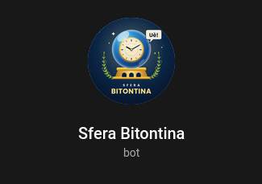
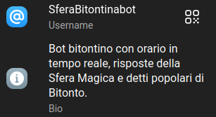
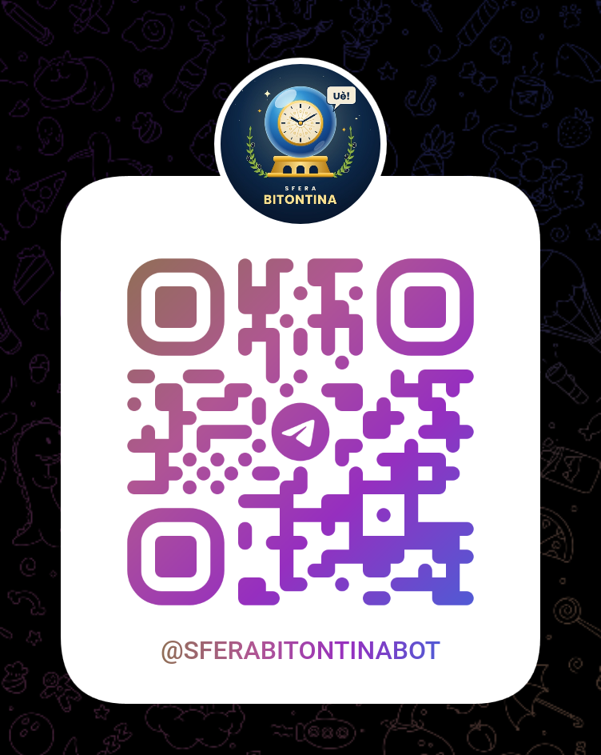

  <!-- BOT LOGO -->
  

  <h1>🔮 SFERA BITONTINA TELEGRAM BOT</h1>
  
<i>Il bot Telegram folkloristico in dialetto bitontino sviluppato in Java</i>

  <!-- BADGES -->
  

    
    
    
    
    
  

 

  <h2 style="color: #d9b45a; text-transform: uppercase; margin-top: 0;">🌐 ABOUT THIS REPOSITORY / INFORMAZIONI SUL PROGETTO</h2>
  
<b>[EN]:</b> <b>Sfera Bitontina Bot</b> is an interactive Telegram bot developed in Java for an academic project at I.I.S.S. Volta - De Gemmis. It integrates traditional Bitonto dialect proverbs, a localized Magic 8-Ball oracle, real-time dialectal clock functions, and user command logging.

  
<b>[IT]:</b> <b>Sfera Bitontina Bot</b> è un bot Telegram interattivo sviluppato in Java come progetto scolastico per l'I.I.S.S. Volta - De Gemmis di Bitonto. Integra proverbi tradizionali in dialetto bitontino, un oracolo stile "Sfera Magica 8", l'orario in tempo reale tradotto in vernacolo e il tracciamento in console dei comandi degli utenti.

 

<!-- BOT INFO & QR CODE PREVIEW -->

  <table border="0">
    <tr>
      <td align="center" valign="middle" width="50%">
        <h3>📱 BOT PROFILE & INFO</h3>
        
      </td>
      <td align="center" valign="middle" width="50%">
        <h3>⚡ SCAN TO CHAT</h3>
        
      </td>
    </tr>
  </table>

 

  <h3 style="text-transform: uppercase; margin-top: 0; color: #a01818;">⚡ CORE HIGHLIGHTS & COMMANDS / PUNTI CHIAVE E COMANDI</h3>
  <ul>
    <li><b><code>/start</code>:</b> Messaggio di benvenuto in dialetto bitontino.</li>
    <li><b><code>/orario</code>:</b> Restituisce l'ora e i minuti attuali espressi in dialetto locale.</li>
    <li><b><code>/sfera</code>:</b> Risposte casuali dell'oracolo magico in vernacolo bitontino.</li>
    <li><b><code>/proverbio</code>:</b> Selezione casuale tra antichi proverbi e detti popolari di Bitonto.</li>
    <li><b><code>/crediti</code>:</b> Informazioni sull'autore, la classe e l'istituto scolastico.</li>
  </ul>
  

  
<b>Developer / Sviluppatore:</b> Giuseppe Caldarola (classe 2008), studente presso <b>I.I.S.S. Volta - De Gemmis</b> (Bitonto).

 

  <h3 style="text-transform: uppercase; margin-top: 0; color: #a01818;">🔒 LICENSE / LICENZA</h3>
  
<b>Copyright (c) 2026 Giuseppe Caldarola. All rights reserved.</b>

  
This project is proprietary software created for academic purposes. No part of this repository or its source code may be reproduced, modified, distributed, or used in any form without prior written permission from the author.

 

  
<b>🔗 LINKS & DONATIONS</b>

  
  
    
  

